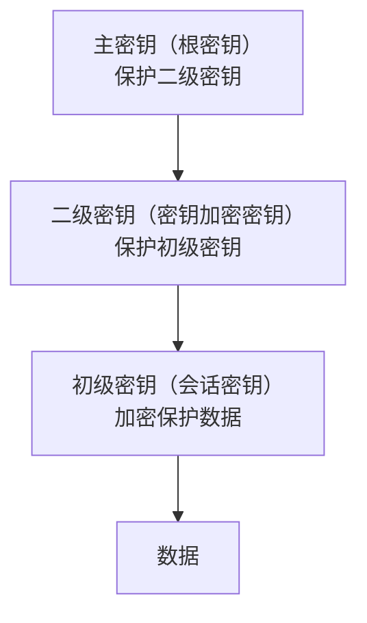
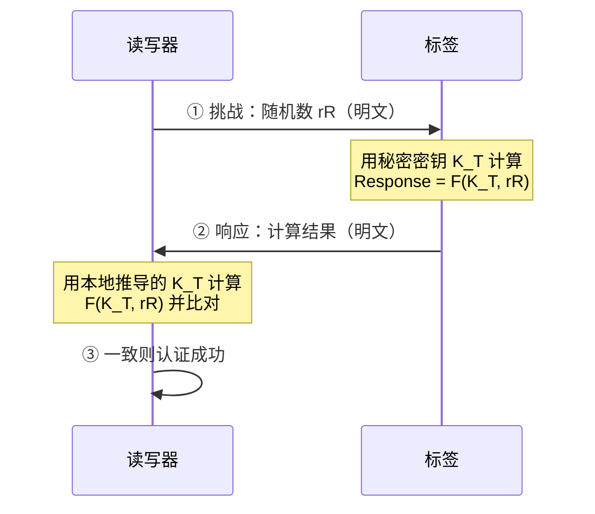
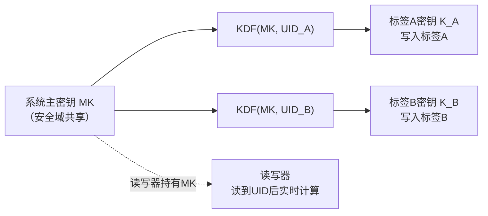
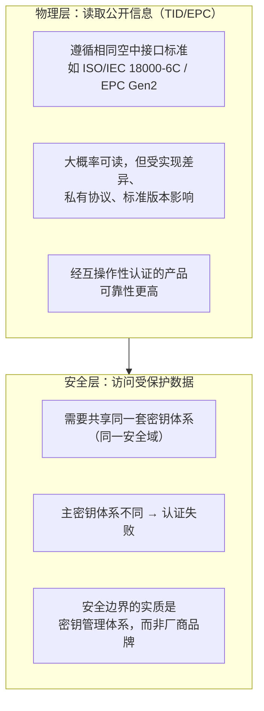
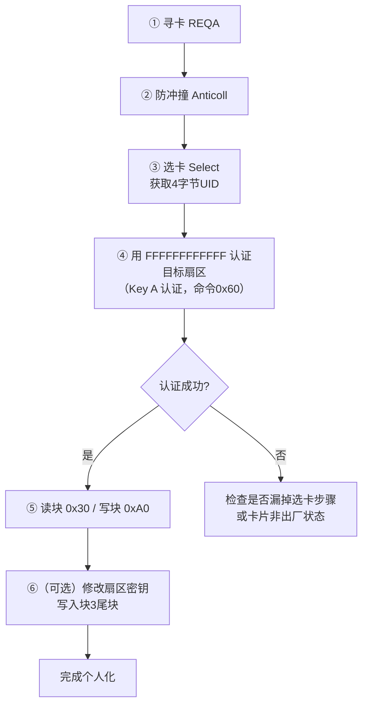
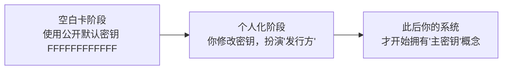

## 引言

在RFID开发中，密钥管理和认证机制是最容易产生困惑的部分。许多开发者会有这样的直觉性质疑：密钥总得在读写器和标签之间传吧？读写器凭什么能算出随机标签的密钥？空白卡认证到底用什么密钥？不同厂商的设备能不能互通？

这些疑问的根源，往往是把"已部署系统的安全机制"和"空白卡的出厂状态"混为一谈，或者把"物理层通信"和"安全层认证"混为一谈。本文把这些常见困惑直接汇总，逐一阐述其背后的原理，并给出基于STM32+RC522操作Mifare Classic空白卡的完整实战指南。

<!-- more -->

---

## 一、三级密钥体系：层级与职责

RFID系统的密钥通常分为三层：



| 层级 | 名称 | 职责 |
|------|------|------|
| 主密钥 | 根密钥 | 保护二级密钥，是整个安全域的根基 |
| 二级密钥 | 密钥加密密钥（KEK） | 加密保护初级密钥 |
| 初级密钥 | 会话密钥/数据加密密钥 | 对数据加解密，原则上一次一密 |

初级密钥保护数据，二级密钥保护初级密钥，主密钥保护二级密钥——层层递进，构成完整的安全体系。

---

## 二、核心困惑一：一次性密钥需要在读写器和标签之间传递吗？

**结论：不需要。** 直接传输密钥本身会引入极大风险。实际机制是：

> 双方利用预先共享的根密钥和公开的协商参数，在本地各自独立推导出完全相同的初级密钥，密钥本身不出现在空中接口上。

### 挑战-响应机制

实现这一目标的核心是**挑战-响应（Challenge-Response）**：



关键点：
- 标签只发送**运算结果**，秘密密钥从未离开标签；
- 每次 `rR` 不同，攻击者无法重放上一次的响应；
- 认证验证的是**动态的、基于密码学的身份真实性**，而非静态的"是否属于同一系统"。

---

## 三、核心困惑二：读写器为什么能"知道"某个标签的密钥？

这是最容易产生误解的地方。**读写器并不是"凭空知道"某个随机标签的密钥，而是因为该标签的密钥在初始化时就是由同一个系统级主密钥派生出来并写入标签的。**

### 密钥分散机制



公式表达：

```
标签密钥 K_T = KDF(系统主密钥 MK, 标签唯一ID)
```

- **标签内部**只保存派生出的 K_T，不保存 MK；
- **读写器**保存 MK，不保存所有标签的 K_T；
- 读写器读到标签 UID 后，用同一个 MK 和同一个 KDF **实时算出** K_T，再用于挑战-响应认证。

### 举例

```
MK = 系统主密钥（所有合法读写器共享）
标签A UID = 1001 → K_A = HMAC(MK, 1001)
标签B UID = 1002 → K_B = HMAC(MK, 1002)

标签A里只存 K_A；标签B里只存 K_B。
读写器存 MK。读到 UID=1001，算出 K_A；读到 UID=1002，算出 K_B。
```

攻击者知道 UID=1001 也没用——不知道 MK，算不出 K_A，且 KDF 是单向的。

### 为什么"标签是随机的"不影响可推导性？

要区分"什么随机"：
- **标签UID可以是随机或唯一的**——KDF 的输入就是 UID，UID 不同，派生出的 K_T 不同；
- **标签密钥 K_T 不是标签自己随机生成的**——它是在发行时由系统用 MK 和该标签 UID 算出来再写入的。

所以对每个标签来说 K_T 独一无二；对系统来说它是**可复现的**：MK 和 UID 相同，算出的 K_T 就相同。

**真正让第三方无法推导的，是主密钥保密和KDF单向性，而非UID的随机性。**

---

## 四、核心困惑三：主密钥是谁定义、谁部署的？

主密钥的**定义者**和**部署者**不是同一个单一角色：

| 角色 | 职责 |
|------|------|
| 标准组织 | 规定密钥管理框架（如要求建立密钥管理中心KMC） |
| 系统集成商/方案商 | 设计密钥体系，选择算法和分散规则 |
| 芯片/标签制造商 | 在特定模式下固定注入初始密钥 |
| 密钥管理中心（KMC） | 在HSM中生成并存储根密钥，向下游派发 |
| 标签发行方（Issuer） | 在个人化阶段将派生密钥安全写入每枚标签 |

最终，**主密钥归属于控制特定"安全域"的实体**——可以是一家银行（控制其支付卡）、一个政府机构（控制其电子证件），或一个大型企业（控制其内部资产标签）。**谁控制了发行环节和密钥注入权，谁就是其安全域内主密钥的实际部署者和所有者。**

---

## 五、核心困惑四：A厂商读写器能读B厂商标签吗？

需要**分层**回答：



- **物理层**：遵循同一标准（如EPC Gen2）的设备通常能完成基础通信，读取公开的TID/EPC。"能读到"是大概率事件，但"稳定可靠地读到"取决于是否经过兼容性验证。
- **安全层**：即使物理信号通畅，若双方不属于同一安全域（不共享同一主密钥体系），A厂商读写器也无法解密或认证B厂商标签的受保护数据。

---

## 六、核心困惑五：操作空白卡，我不知道主密钥MK怎么办？

**这是最关键的一个澄清：对于空白标签卡，根本不存在一个需要你去寻找的"系统主密钥MK"。**

"主密钥派生标签密钥"的机制，针对的是**已经由某个系统完成"个人化"的正式标签**。而你手中的空白Mifare Classic卡处于**出厂状态**，使用的是公开的、统一的**出厂默认密钥**——目的就是让任何人都能方便地初始化和测试。

### 空白卡的默认密钥

对于绝大多数空白/出厂状态的Mifare Classic卡，**所有扇区使用的默认密钥完全相同**：

- **Key A** = `FF FF FF FF FF FF`
- **Key B** = `FF FF FF FF FF FF`（或未启用）

> **理解方式**：每个扇区在硬件上独立存储密钥，但出厂时所有扇区的密钥存储区域被统一初始化为相同的值。可以类比为：每个扇区都有一把独立的"锁"，但出厂时所有"锁"都配了同一把公开的"万能钥匙"`FF FF FF FF FF FF`。

**特殊情况**：部分其他厂商兼容芯片或特定用途卡可能使用其他公开默认值（如 `A0 A1 A2 A3 A4 A5` 或 `D3 F7 D3 F7 D3 F7`），但对于全新购买的原始空白卡，全`FF`是最通用、最应首先尝试的。

---

## 七、实战：STM32+RC522操作Mifare Classic空白卡

### 完整流程



### 分步说明

**第1步：寻卡、防冲撞、选卡，获取UID**

STM32通过SPI驱动RC522，依次发送寻卡（`REQA`）、防冲撞（`Anticoll`）和选卡（`Select`）指令，获取卡片的4字节UID。

> ⚠️ 很多新手卡在"认证失败"，根源就是**漏掉了"选卡"这一步**，导致卡片没有进入可认证的状态。

**第2步：用默认密钥进行扇区认证**

拿到UID后，用默认密钥 `FF FF FF FF FF FF`（作为Key A）对目标扇区认证。例如对第1个扇区（块地址为4）操作，命令RC522使用`0x60`（Key A认证）和该默认密钥去认证块4。

**第3步：读写数据**

认证通过后，使用RC522的读块（`0x30`）和写块（`0xA0`）指令读写数据。Mifare Classic的认证以**扇区**为单位——认证了某个扇区，该扇区下所有数据块就都对你开放。

**第4步（可选）：修改密钥，实现"个人化"**

每个扇区的**块3（尾块）**存放密钥（Key A + 访问控制位 + Key B）。用默认密钥认证后，可向块3写入新密钥。

> ⚠️ **警告**：一旦写入新密钥并且忘记，或错误配置了访问控制位（AC Bits），这个扇区可能被**永久锁定**，再也无法修改或读取。修改前务必完整理解扇区尾块结构。

### "主密钥MK"概念何时登场？



在你**开始修改密钥、部署自己的安全体系**（即个人化）时，"主密钥MK"的概念才真正引入。从那时起，你（或你的系统）就扮演了"发行方"的角色，由你来定义新的密钥规则。

---

## 八、常见困惑汇总表

| 困惑 | 澄清 |
|------|------|
| 一次性初级密钥需要传输吗？ | 不需要，双方利用共享根密钥和公开参数**本地推导** |
| 读写器为什么能算出标签密钥？ | 标签密钥 = KDF(系统主密钥, UID)，读写器持有主密钥可**复现计算** |
| 标签UID是随机的，为什么能推导？ | UID随机只影响派生结果不同；K_T是发行时由系统算好写入的，**不是标签自己随机生成的** |
| 主密钥是谁的？ | 属于控制特定**安全域**的实体（KMC/发行方） |
| A厂商读写器能读B厂商标签吗？ | **物理层**大概率可读公开信息；**安全层**取决于是否同一密钥管理体系 |
| 空白卡认证需要主密钥吗？ | **不需要**，空白卡使用公开的出厂默认密钥 `FFFFFFFFFFFF` |
| "主密钥MK"概念何时引入？ | 在开始修改密钥、部署自己的安全体系（**个人化**）时才引入 |
| 认证到底在确认什么？ | 确认"对方持有合法密钥、消息是当前会话实时生成的"，而非核对厂商归属 |

---

## 九、结语

RFID密钥体系的设计精髓在于：**密钥不传输，只协商参数，本地推导**。读写器与标签通过预共享的根密钥进行双向认证，各自独立推导出会话密钥，核心密钥材料从未在开放信道上传输。而跨厂商互操作的边界，不是"厂商品牌"，而是"密钥管理体系（安全域）"。

对于开发者手中的空白卡，一切从简——用公开的出厂默认密钥 `FF FF FF FF FF FF` 认证即可。只有当你开始修改密钥、构建自己的安全域时，"主密钥"的概念才真正登场。届时，你（或你的系统）就扮演了"发行方"的角色，由你来定义新的密钥规则。